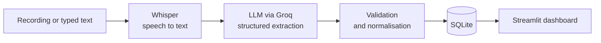

# AI Reception & Lead Management Agent

Turns phone calls into prioritised leads. A call recording is transcribed with Whisper, an LLM
extracts the caller's intent, urgency and sentiment, scores how ready they are to enrol, and drafts
a reply. Staff work from a ranked list in a web dashboard instead of handwritten notes.

## What it does

- **Three ways to add a call:** upload a recording, record in the browser, or type a transcript
- **Structured extraction:** intent, urgency, sentiment, name, phone number, course of interest, summary, tags
- **Lead score (0 to 100)** with a one-line reason, and a suggested reply staff can edit before saving
- **Dashboard** with totals, charts and the leads to follow up on first
- **Leads page** with search, filters, status tracking (New, Contacted, Converted, Closed) and CSV export
- **Output validation:** JSON mode, one retry, and normalisation so the database only holds allowed values
- **Evaluation harness** with a labelled test set, per-stage metrics and a before/after prompt comparison

## How it works



Whisper and the LLM (OpenAI's open-weight GPT-OSS by default) both run through [Groq](https://console.groq.com), which has a free tier. Groq retires models now and then, so the app falls back to another model automatically if the configured one is gone.

## Quick start

You need Python 3.10 or newer and a free Groq API key.

```bash
git clone https://github.com/<your-username>/ai-reception-lead-agent.git
cd ai-reception-lead-agent

python -m venv .venv
source .venv/bin/activate          # Windows: .venv\Scripts\activate
pip install -r requirements.txt

cp .env.example .env               # then paste your key into .env
streamlit run app.py
```

Open the address Streamlit prints. On the Dashboard, choose **Load demo leads** to explore the app
without using any API calls.

### Command line

```bash
python cli.py text "Hi, I want to join the Python course. Please call me today."
python cli.py audio call1.m4a call2.wav
python cli.py list --sort score
python cli.py stats
```

## Evaluation

The pipeline is tested against 25 scripted calls with ground-truth labels, across clear, ambiguous,
multi-intent, noisy and accented (code-mixed) speech.

```bash
python -m evaluation.run_eval --prompt v1      # baseline prompt
python -m evaluation.run_eval --prompt v2      # refined prompt
python -m evaluation.compare text-v1 text-v2   # before and after
python -m evaluation.run_eval --audio          # end to end, with your own recordings
```

It reports intent and urgency accuracy, name and phone extraction, how often the model returns valid
JSON on the first try, and, in audio mode, Whisper's word error rate. Every failed case is saved with
the raw model output. Reports are written to [`evaluation/results/`](evaluation/results) and shown on
the app's Evaluation page. The method, labelling rules and limits are in
[`evaluation/README.md`](evaluation/README.md).

## Project structure

```
app.py                 Streamlit app
cli.py                 Command-line interface
agent/
  config.py            Settings and allowed values
  prompts.py           Prompt versions v1 (baseline) and v2 (refined)
  llm.py               Whisper and LLM calls, parsing, validation
  database.py          SQLite storage
  sample_data.py       Demo leads
evaluation/
  test_set.json        25 labelled calls
  run_eval.py          Runs the pipeline and computes metrics
  compare.py           Compares two runs
  metrics.py           Word error rate and matching helpers
  results/             Reports from each run
tests/                 Unit and app tests
```

## Configuration

Set these in `.env` or as environment variables.

| Variable | Default | Purpose |
|---|---|---|
| `GROQ_API_KEY` | none | Your Groq key (can also be entered in the app sidebar) |
| `GROQ_CHAT_MODEL` | `openai/gpt-oss-120b` | Model used for extraction |
| `GROQ_WHISPER_MODEL` | `whisper-large-v3-turbo` | Model used for transcription |
| `DB_PATH` | `data/calls.db` | Location of the SQLite database |
| `API_TIMEOUT_S`, `API_MAX_RETRIES` | `30`, `3` | Request timeout and automatic retries |

## Tests

```bash
pip install -r requirements-dev.txt
pytest
```

The tests use a fake model client, so they need no API key or network. They cover parsing and
validation, the database, the evaluation metrics and the app's main flows.

## Limitations

- It processes recordings and typed text. It is not connected to a live phone line.
- The lead score is the model's judgement, guided by the prompt. It has not been checked against real enrolment outcomes.
- Accuracy is measured on a small set of scripted calls, so it indicates behaviour rather than guaranteeing it on real traffic.
- The prompts are in English. Hindi, Kannada and Tamil mixed with English are tested in the evaluation set, but there is no dedicated multilingual handling.
- SQLite suits a single user. A multi-user deployment would need a server database.
- Calls contain personal details. Get consent before recording, and do not commit real recordings or the database.

## Roadmap

- Connect to a phone system's call recordings
- WhatsApp or email follow-up from the suggested reply
- Track which scored leads actually enrol, to calibrate the score
- Authentication and a server database for multi-user use

## License

MIT. See [LICENSE](LICENSE).
